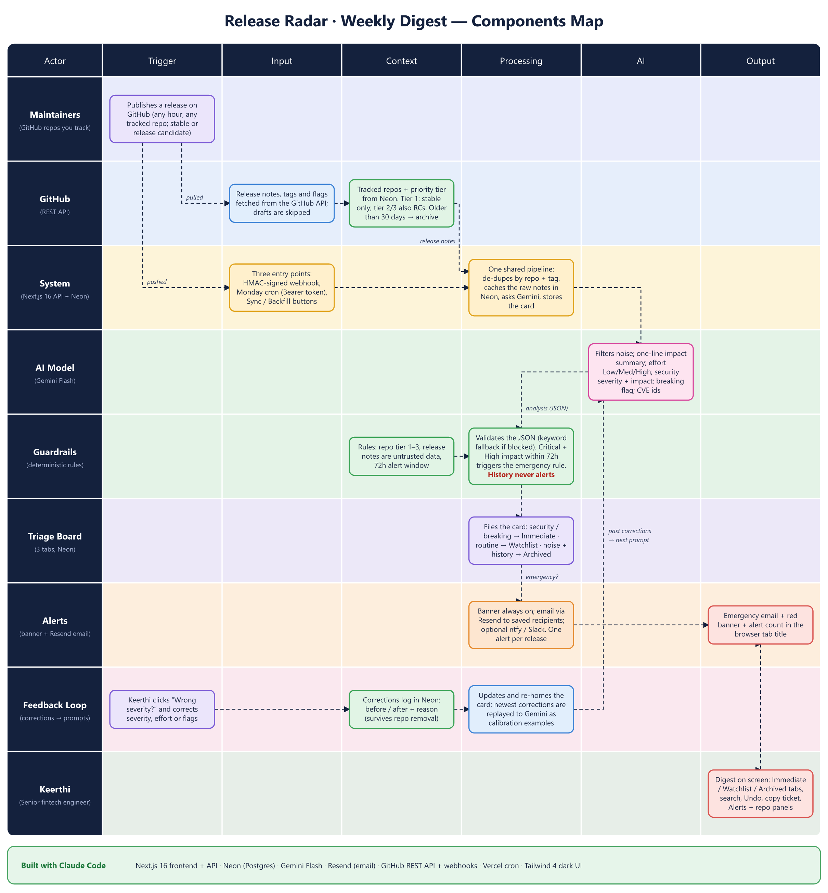
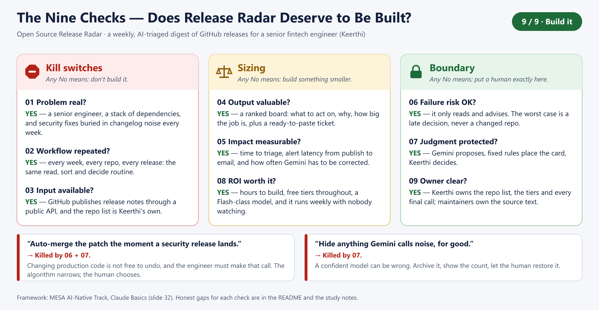

# Open Source Release Radar

An AI-triaged weekly digest of GitHub releases for the repositories you depend on — a
"Developer Triage Board" where security fixes and breaking changes surface first and
routine noise is filtered out.

**Live demo: <https://release-radar-rust.vercel.app>** — opens straight to the digest, no sign-in.

- **Next.js 16** (App Router) · **Tailwind CSS 4** · **Lucide** icons
- **Neon PostgreSQL** (`@neondatabase/serverless`) — tracked repos, cached releases, triage state, feedback log
- **Gemini Flash** — noise filtering, one-line impact summary, effort score, security severity/impact, breaking-change flag
- **Vercel** — deployment target, with a weekly Cron job

## What it does

| | |
|---|---|
| **Triage board** | Three tabs in the top bar, one list at a time — *Immediate Triage* (security / breaking), *Watchlist Radar* (routine & evaluation), *Archived / Cleaned* (noise Gemini filtered, items you dismissed, backfilled history). Each tab shows a live count; the active tab is kept in the URL (`#immediate`, `#watchlist`, `#archive`) and `1` `2` `3` switch tabs, `S` starts swipe triage, `?` opens *How it works*. Moving a card shows an **Undo** toast; long lists load 30 at a time. |
| **Guided tour** | Every time the app opens, a short walkthrough spotlights each part of the page (vibe check, swipe button, lists, search, cards, alerts, repos) with a plain explanation. **Skip tour** (or `Esc`) is always on screen, the arrow keys step through it, and nothing is remembered between visits — it shows for everyone, every time. Replay it from *How it works*. |
| **Vibe check** | The top of the page answers "what needs me?" in one human sentence. An emoji sticker, the headline (*Immaculate vibes* → *Lowkey busy* → *Okay, this is a bit sus* → *Patch now. No cap.*) and the glow behind the whole page all change with the worst thing waiting. Under it: three tiles (needs action / watching / noise this week) that open their lists, `security` / `breaking` chips that double as filters, and the pipeline's health — last sync, next auto-sync (in your time zone), how many urgent items are carried over from earlier weeks, and a warning when a repo couldn't be checked. |
| **Swipe triage** | **Start swiping** (or `S`) turns the urgent list into a deck of cards: drag **left to archive**, **right to watch**, **up to copy a ticket** (or use the buttons / arrow keys). `Z` undoes. Clear the deck and you get confetti and *Inbox zero*. Every move is saved like any other triage. |
| **Cards** | Repo, monospace version tag, Gemini's one-line impact, a plain-language **Why it's here** line (severity, impact, tier), an inline **Recommended action**, effort pill (Low / Med / High), advisory ids, a one-click **Copy Release Note / Create Ticket**, and **Show original release notes** to check a summary against GitHub's own text (fetched on demand, shown as plain text). |
| **How it works** | A slide-over (`?`) that explains the pipeline, who decides what (Gemini proposes, fixed rules place and alert, you have the final say) and where the tool falls short. The alert rule it quotes is read live from the server. |
| **Ask My Digest** | Instant search across repo, version, summary, CVE ids… plus `Security Only` / `Breaking Changes` / `All Releases` toggles. Press `/` to focus. |
| **Repo manager** | Slide-over to add (`owner/repo` or a GitHub URL — verified against GitHub), re-prioritise (tier 1–3), pause, or remove repos. No code changes needed. |
| **Backfill** | One click loads up to a year of older releases into the archive (searchable, never alerting). |
| **Weekly ingestion** | `GET /api/ingest` (Vercel Cron, Mondays 12:00 UTC) pulls recent releases, runs them through Gemini, caches the result in Neon. Idempotent — cached releases are never re-analysed. |
| **Live webhook** | `POST /api/webhook/github` ingests a release the moment it's published. |
| **Emergency escalation** | A critical, high-impact security fix raises a dashboard banner and an email / push alert (Resend, ntfy and/or Slack) immediately — it doesn't wait for Monday. Email is managed in the **Alerts** panel (recipients, on/off, test email). |
| **Look & feel** | A near-black page with a point of view: acid lime for "do this", hot pink for danger, ice blue for calm, a chunky display typeface, sticker-style Security / Breaking badges, a card spotlight that follows your cursor, and a faint film grain. Motion respects `prefers-reduced-motion`. Every piece of text meets WCAG AA contrast (4.5:1). |
| **Feedback loop** | Click **Wrong severity?** on any card to correct Gemini. Corrections are logged and replayed to Gemini as calibration examples. |

## Components map

Who and what is involved, from a release being published to Keerthi seeing it (rows = actors, columns =
Trigger → Input → Context → Processing → AI → Output).



## The nine checks: does this deserve to be built?

The MESA "Claude Basics" framework, applied honestly. Kill switches (any No: don't build it), sizing (any No: build
something smaller) and boundary (any No: put a human exactly there). The answers live in
[`lib/nine-checks.ts`](lib/nine-checks.ts), which also feeds the slide below and the *How it works* panel.



| # | Check | Answer | Honest gap |
|---|---|---|---|
| 01 | Problem real? | Yes: a senior engineer, many dependencies, security fixes buried in changelog noise. | The persona comes from the brief, not a user survey. |
| 02 | Workflow repeated? | Yes: weekly cron plus a live webhook, every repo, every release. | Volume varies a lot by repo. |
| 03 | Input available? | Yes: GitHub's public releases API; the repo list is the user's own. | Release notes only (no issues, PRs, commits or advisory databases). |
| 04 | Output valuable? | Yes: ranked lists, severity and impact, effort, recommended action, ready-to-paste ticket. | Only as good as Gemini's classification, hence the original notes link. |
| 05 | Impact measurable? | Yes: timestamps and a correction log are stored. | No before/after baseline measured yet. |
| 06 | Failure risk OK? | Yes, with a human gate: it only reads and advises, and nothing is deleted. | A missed critical CVE costs more than a bad movie pick; Gemini has no fixed test set yet. |
| 07 | Judgment protected? | Yes: Gemini proposes, fixed rules place the card, the user decides. | Gemini's noise flag archives a card without asking (the *Noise this week* tile keeps it visible). |
| 08 | ROI worth it? | Yes: hours to build, free tiers, a Flash-class model, runs unattended. | Free-tier limits cap scale. |
| 09 | Owner clear? | Yes: the user owns repos, tiers and every final call. | The dashboard has no sign-in by design; `DASHBOARD_PASSWORD` locks it. |

Ideas the checks kill: *"auto-merge the patch the moment a security release lands"* (killed by 06 + 07) and *"hide
anything Gemini calls noise, for good"* (killed by 07). The algorithm narrows; the human chooses.

## Setup

```bash
npm install
cp .env.example .env.local     # then fill it in
npm run dev                    # http://localhost:3000
```

1. **Neon** — create a project, copy the *pooled* connection string into `DATABASE_URL`.
   The schema is applied automatically on the first request (it's idempotent and additive);
   [`db/schema.sql`](db/schema.sql) is the same DDL if you'd rather run it by hand.
2. **Gemini** — create a key at <https://aistudio.google.com/apikey> → `GEMINI_API_KEY`.
   The model defaults to `gemini-3.8-flash`; override with `GEMINI_MODEL`.
3. **GitHub** — a fine-grained token with no extra permissions (public repos, read-only) →
   `GITHUB_TOKEN`. Without it GitHub allows only 60 requests/hour.
4. Open the app. Add repos in **Manage repos**, or click **Load sample data** to load the fictional
   records in [`db/seed.json`](db/seed.json) (clearly badged *Sample*, removable in one click, and
   excluded from AI tuning).

## Real-time features

### 1. GitHub webhook — `POST /api/webhook/github`

> GitHub only lets you add a webhook to repositories **you administer** (or an organisation you own).
> For third-party open-source projects such as `stripe/stripe-python` you can't — the weekly sync (and
> **Sync now**) covers those. Use the webhook for your own / your company's libraries.

In the repo (or organisation) → **Settings → Webhooks → Add webhook** — or with the GitHub CLI:

```bash
gh api repos/OWNER/REPO/hooks -f name=web -F active=true \
  -f 'config[url]=https://<your-app>/api/webhook/github' -f 'config[content_type]=json' \
  -f "config[secret]=$GITHUB_WEBHOOK_SECRET" -f 'events[]=release'
```

Either way the settings are:

| Field | Value |
|---|---|
| Payload URL | `https://<your-app>/api/webhook/github` |
| Content type | `application/json` |
| Secret | the value of `GITHUB_WEBHOOK_SECRET` (`openssl rand -hex 32`) |
| Events | *Let me select* → **Releases** only |

How it behaves:

- Authenticates every request with `X-Hub-Signature-256` (HMAC-SHA256 over the raw body, constant-time
  compare). Without `GITHUB_WEBHOOK_SECRET` it refuses to run at all (503).
- Handles `release` events with action `published` / `released`. Ignores drafts, repositories you
  don't track, releases already cached, and — for **tier 1** repos — prereleases.
- Replies `202` immediately (GitHub gives up after 10 s) and does the work in the background with
  `after()`: Gemini analysis → write to Neon tagged `ingest_source = 'webhook'` (shown as a **Live**
  badge) → escalation check.
- Only the *release* (tag, title, notes) goes to Gemini — not the whole payload.
- If the background work fails (e.g. Gemini outage) nothing is cached, and the next scheduled or manual
  sync picks the release up. The webhook makes things faster; it is never the only path.

### 2. Emergency escalation

Every newly analysed release (webhook **and** scheduled sync) is run through a small, auditable rule
engine ([`lib/escalation.ts`](lib/escalation.ts)). By default it fires when **all** of these hold:

- Gemini rated it a security fix with severity **critical**
- Gemini rated its impact on a typical production deployment **High**
- it was published within the last **72 hours** (so adding an old repo, or a backfill, can't trigger an alert storm)
- it was rated by Gemini (the keyword fallback can never page anyone)

When it fires, the alert goes out immediately — it doesn't wait for Monday — through whichever channels you have:

| Channel | Setup | |
|---|---|---|
| **Dashboard banner** | none — always on | A red banner pinned above the board and a `(1) 🚨` prefix on the browser tab until you triage the card. |
| **Email (Resend)** | `RESEND_API_KEY` on the server, then the **Alerts** panel | A formatted email with severity, impact, advisories, recommended action and links. Open **Alerts** in the top bar to switch it on, add up to 5 recipients, and **Send test email** (rate-limited to one per 30 s). Settings are saved in Neon and apply immediately; until you save them once, `ALERT_EMAIL_TO` (comma-separated) is the default. Addresses are shown masked, since the dashboard can be public. Create a free key at [resend.com](https://resend.com). **Without a verified domain Resend only delivers to the address you signed up with** — fine for a personal alert; to email others, verify a domain in Resend and set `ALERT_EMAIL_FROM` (e.g. `Release Radar <alerts@yourdomain.com>`). Retries reuse an idempotency key, so a retry can never send two emails. |
| **ntfy push** | set `NTFY_TOPIC` | Free push notifications to your phone or desktop, **no account needed**. Install the ntfy app (or open `https://ntfy.sh/<topic>`) and subscribe to your topic. Sent at *urgent* priority with a link to the release. The topic name is the only secret — make it long and random. |
| **Slack** | set `SLACK_WEBHOOK_URL` | Optional — **you don't need Slack.** A Slack [incoming webhook](https://api.slack.com/messaging/webhooks). |

Channels are independent and all optional: configure any combination, and one failing never blocks the others.

Tune the rule with `ESCALATION_MIN_SEVERITY`, `ESCALATION_MIN_IMPACT`, `ESCALATION_MAX_TIER`,
`ESCALATION_MAX_AGE_HOURS`; add a Slack ping with `SLACK_MENTION=<!here>`; add a dashboard link with `APP_URL`
(on Vercel the production URL is picked up automatically).

- Alerts fire at most once per release (only newly inserted rows are evaluated, so webhook redeliveries
  are harmless). Slack and ntfy are tried independently, each retried on network errors / 429 / 5xx.
- Cards show where the alert got to: **Emergency** (dashboard only), **Alert sent**, or **Alert failed**
  (a configured channel didn't deliver — the release is still saved).
- Untrusted release text is escaped (Slack) or stripped to ASCII (ntfy headers) before it leaves the
  app, so a release note can't inject `@channel` pings, links or headers.

Test your channel without touching the app:

```bash
curl -X POST https://api.resend.com/emails -H "Authorization: Bearer $RESEND_API_KEY" -H 'Content-Type: application/json' \
  -d "{\"from\":\"Release Radar <onboarding@resend.dev>\",\"to\":[\"$ALERT_EMAIL_TO\"],\"subject\":\"Release Radar test\",\"text\":\"It works.\"}"
curl -H 'Priority: urgent' -d 'Release Radar test' "https://ntfy.sh/$NTFY_TOPIC"
curl -X POST -H 'Content-Type: application/json' -d '{"text":"Release Radar test"}' "$SLACK_WEBHOOK_URL"
```

### Backfilling history

**Manage repos → Backfill history** loads older releases (last 90 days / 6 months / year) for every active
repo — handy right after adding repos. It works through the history in batches (10 releases per repo per
request) and shows progress; if Gemini rate-limits it pauses and you can simply run it again. The same
thing is available as `POST /api/ingest` with `{ "days": 365, "backfill": true }` — call it again while
`remaining` in the response is above 0.

Anything older than 30 days is filed straight into **Archived / Cleaned** (it's history, not news): still
searchable and filterable, restorable to the board, and never alerting. GitHub returns at most the 100
most recent releases per repo, which bounds how far back very active repos can go. Tier 1 repos skip
prereleases, as in normal syncs.

### 3. AI feedback loop — `POST /api/feedback`

Each card has a subtle **Wrong severity?** link. It opens a panel pre-filled with Gemini's answer where
you can correct the security severity, effort, breaking-change flag, or mark it as routine noise, with an
optional reason.

- The before/after is logged to `release_feedback` in Neon (denormalised, so it survives deleting the
  repo). `GET /api/feedback` lists the log.
- The card is updated immediately and re-homed if its new flags warrant it (a false-alarm security card
  leaves *Immediate Triage*; a card you'd already archived by hand stays where you put it).
- **The loop closes at ingestion:** before analysing a new release, the app loads your most recent
  corrections — for the same repository first — and includes them in Gemini's prompt as calibration
  examples ("Keerthi corrected security severity: critical → none; reason: …"). Over time Gemini learns what
  counts as noise, breaking, or critical *for your stack*, which is what cuts alert fatigue.
- Sample (fictional) releases can't be corrected, so they never pollute the tuning data.

## Deploying to Vercel

1. Push the repo and import it in Vercel.
2. Add the environment variables from `.env.example` (at minimum `DATABASE_URL`, `GEMINI_API_KEY`,
   `GITHUB_TOKEN`, `CRON_SECRET`; add `GITHUB_WEBHOOK_SECRET`, `DASHBOARD_PASSWORD` to require a login, and
   `RESEND_API_KEY` + `ALERT_EMAIL_TO` (and/or `NTFY_TOPIC`, `SLACK_WEBHOOK_URL`) for the real-time
   features). Or from the CLI:
   `printf '%s' "$VALUE" | vercel env add NAME production --sensitive`.
3. [`vercel.json`](vercel.json) registers the weekly cron (`0 12 * * 1`, Mondays 12:00 UTC). Vercel sends
   `Authorization: Bearer $CRON_SECRET`; the route returns 401 without it, and refuses to run in
   production if `CRON_SECRET` is unset.
4. Add the GitHub webhook (above) pointing at your production URL.

**Access control is optional.** By default the app is **open**: visitors go straight to the digest, which
suits a demo or a submission. Be aware that anyone with the link can then use the dashboard's own
actions (add / remove repos, sync, backfill, corrections). To lock it down, set `DASHBOARD_PASSWORD`:
[`proxy.ts`](proxy.ts) then puts the whole app behind HTTP Basic auth (the browser shows its sign-in
prompt once; any username, that password). Two endpoints are always exempt because they authenticate
themselves: `POST /api/webhook/github` (HMAC signature) and `GET /api/ingest` (Bearer `CRON_SECRET`).
If you also enable Vercel Authentication, exclude those two paths, or GitHub and Vercel Cron will be
locked out.

## API

| Route | |
|---|---|
| `GET /api/releases` | Board data + header counters |
| `PATCH /api/releases/:id` | Move a card (`{ triageColumn }`) |
| `GET /api/releases/:id/notes` | The original GitHub release notes behind a summary (plain text, capped at 20,000 characters) |
| `GET/POST /api/repos` · `PATCH/DELETE /api/repos/:id` | Manage tracked repositories |
| `GET/PUT /api/alerts` · `POST /api/alerts/test` | Email alert settings (masked) · send a labelled test email to the saved recipients |
| `POST /api/feedback` · `GET /api/feedback` | Correct a classification · list the log |
| `GET /api/ingest` | Weekly cron (`CRON_SECRET`) |
| `POST /api/ingest` | Manual sync / backfill (`{ repositoryId?, days?, backfill? }`) |
| `POST /api/webhook/github` | GitHub release webhook (HMAC-signed) |
| `POST/DELETE /api/seed` | Load / remove the sample data |

## Project layout

```
proxy.ts                      access gate (Basic auth) for everything but the webhook + cron routes
app/
  page.tsx                    dashboard (client component)
  api/…                       route handlers (above)
components/                   TopBar, Board, ReleaseCard, FeedbackPanel, RepoDrawer, Badges, …
lib/
  db.ts  schema.ts            Neon client + idempotent DDL
  gemini.ts                   Gemini Flash prompt, schema, validation, fallback
  github.ts  webhook.ts       GitHub REST client · webhook signature + payload parsing
  ingest.ts                   processRelease(): analyse → store → escalate (shared by cron + webhook)
  escalation.ts               rule engine + Slack alerts
  feedback.ts                 correction log + calibration examples
  repos.ts  releases.ts  seed.ts
db/  schema.sql  seed.json
```

## Notes

- Gemini returns structured JSON that is validated and coerced server-side; if a response is blocked
  or unparseable the release falls back to conservative keyword rules (flagged *keyword fallback*) and
  never triggers an emergency alert. Transport/auth failures cache nothing, so the next sync retries.
- Release notes are untrusted input. They're delimited and labelled as data in the prompt, output is
  schema-constrained and rendered as plain text, and only `github.com` links are ever rendered.
- Tier 1 repos track stable releases only; tier 2/3 (evaluation tools) also surface release candidates.
